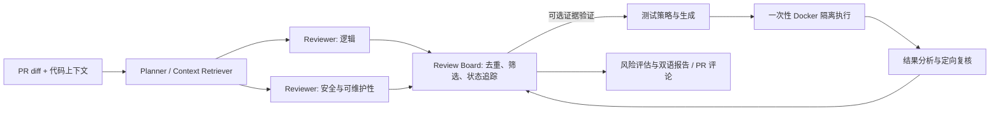
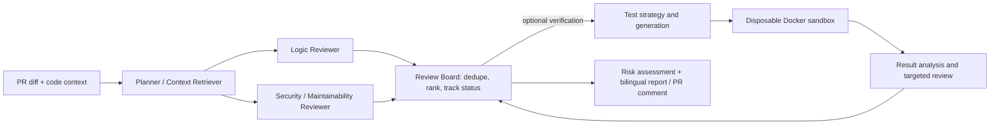

# CodeCross

[中文](#中文) · [English](#english)

## 中文

CodeCross 是一个多智能体 PR 代码评审工具：读取 diff 和相关代码上下文，运行独立 Reviewer，去重与筛选问题，并可生成双语报告和 GitHub PR 评论。可选的证据验证环节会尝试运行 AI 生成的测试；**默认只在一次性 Docker 容器中执行**，没有可用的 Linux Docker 引擎时标记为 `not_testable`，不会退回宿主机运行。

### 项目速览

面向 AI 应用与研发岗位，这个项目展示了从多 Agent 编排、结构化问题合并，到可控工具执行和可审计评测的一条完整链路。默认由两名独立 Reviewer 审阅同一份 PR；评审问题进入 Review Board 后，可选择性生成测试来补充证据，最后输出带风险级别和验证状态的报告。自动化测试执行与 PR 评审基准是两条不同的路径：SWE-PRBench 的 `review_only` 评测不调用 Docker 测试。



当前可核验的是工程能力与评测流程，而非官方榜单优势：仓库包含真实 Docker 边界测试，以及对 SWE-PRBench 350 个 PR 数据记录的适配和官方输出结构导出；**尚未完成同一基准、同一裁判下与商业 Reviewer 的正式对照**。历史 15 PR 自定义 Judge 诊断见下文，不能当作当前版本或官方成绩。

### 本地安装

需要 Python 3.12+。Windows PowerShell 示例：

```powershell
python -m venv .venv
.\.venv\Scripts\python.exe -m pip install -r requirements.txt
Copy-Item .env.example .env
```

在本地 `.env` 填写模型密钥。`.env` 已被 Git 忽略，不要提交密钥。仅做不调用真实模型的链路检查：

```powershell
.\.venv\Scripts\python.exe -m codecross.ci --diff examples/diffs/safe_divide.diff --project-root . --output-comment comment.md --mock-llm
```

本地运行：

```powershell
.\.venv\Scripts\python.exe -m codecross.main --diff examples/diffs/safe_divide.diff --project-root .
```

### 隔离测试执行

生成的测试会在项目的临时工作副本里运行；不会挂载原始项目目录、`.env`、Git 元数据或宿主机密钥。容器默认断网、非 root、只读根文件系统，并限制 CPU、内存、进程数、时长和输出大小。运行时不会自动拉取镜像或安装依赖；缺少镜像、依赖或 Docker 引擎时，验证结果为不可测试，不应被当作缺陷成立或被反驳的证据。

先启动 Docker Desktop 的 Linux engine，再在可信环境准备 Python 测试镜像：

```powershell
docker build -f docker/sandbox-python.Dockerfile -t codecross-sandbox-python:3.12 .
docker info --format '{{.OSType}}'
```

Go 等原生语言使用已存在的官方语言镜像；镜像与依赖需要在执行前另行准备。`CODECROSS_TEST_EXECUTION_MODE=trusted_local` 只用于**完全可信的本地调试代码**，会恢复宿主机执行风险；Web API 不接受这个覆盖。API 尚无身份认证，只应绑定在本机，不要暴露到公网。

### 评测与对标

- `codecross-eval local`：无付费模型的本地回归评测。
- `swe-prbench-run`：在冻结 PR 上运行 Reviewer；它采用 `review_only`，**不测试沙箱或证据验证能力**。
- `swe-prbench-score`：使用 CodeCross 自定义 Judge 的内部诊断分；缺失任务、无输出、无效运行会单独列出，不能与官方榜分直接比较。
- `swe-prbench-export`：导出 [SWE-PRBench](https://github.com/FoundryHQ-AI/swe-prbench) v0.4.1 `AgentOutput` 结构供官方 harness 评分；导出本身不是官方成绩。

SWE-PRBench 是 PR 评审基准；原版 SWE-bench 是 issue 修复基准，两者的分数不能混用。与 CodeRabbit 等市面工具的横向比较，需要在 [ReviewBench](https://github.com/review-bench/ReviewBench) 等**相同任务和相同裁判**下完成，当前仓库不宣称已有官方同榜成绩。评测命令详见 [evals/README.md](evals/README.md)；历史 15 PR 的局限分析见 [v0.25 离线诊断](docs/evaluation-diagnosis-v025.md)。

### 验证与 GitHub CI

```powershell
.\.venv\Scripts\python.exe -m pytest -q
```

GitHub Actions 使用仓库 Secrets/Variables，不从源码读取密钥。模型相关配置包括 `DEEPSEEK_API_KEY`、`DEEPSEEK_BASE_URL`、`DEEPSEEK_MODEL`、`ANTHROPIC_API_KEY`、`ANTHROPIC_BASE_URL`、`ANTHROPIC_MODEL`；评测可选 `CODECROSS_HUMAN_ALIGNMENT_PRIMARY_PROVIDER`，链路测试可用 `CODECROSS_MOCK_LLM`。

## English

CodeCross is a multi-agent pull-request reviewer. It reads a diff and focused repository context, runs independent reviewers, deduplicates and ranks findings, and can produce a bilingual report or a GitHub PR comment. Its optional evidence-verification loop runs AI-generated tests **only in disposable Docker containers by default**. If a Linux Docker engine is unavailable, the result is `not_testable`; it never silently falls back to the host.

### Project at a glance

The project demonstrates an end-to-end AI application workflow: multi-agent orchestration, structured finding consolidation, controlled tool execution, and auditable evaluation. Two independent reviewers inspect a PR by default. Findings enter a Review Board, where optional generated tests can add evidence before the system produces a risk assessment, bilingual report, and PR comment. Automated test execution is separate from the `review_only` SWE-PRBench path, which does not invoke Docker tests.



The current evidence supports engineering and evaluation-readiness claims, not leaderboard superiority: the repository includes real Docker boundary tests, support for the 350-PR SWE-PRBench data records, and an exporter for the official output schema. **A controlled, same-benchmark comparison against commercial reviewers has not yet been run.** The historical 15-PR custom-judge diagnosis below is neither a current-version nor an official score.

### Local setup

Python 3.12+ is required. On Windows PowerShell:

```powershell
python -m venv .venv
.\.venv\Scripts\python.exe -m pip install -r requirements.txt
Copy-Item .env.example .env
```

Put model credentials in your local `.env`, which Git ignores. To check the wiring without paid model calls:

```powershell
.\.venv\Scripts\python.exe -m codecross.ci --diff examples/diffs/safe_divide.diff --project-root . --output-comment comment.md --mock-llm
```

To run a local review:

```powershell
.\.venv\Scripts\python.exe -m codecross.main --diff examples/diffs/safe_divide.diff --project-root .
```

### Isolated test execution

Generated tests run against a temporary project copy. The original checkout, `.env`, Git metadata, and host credentials are not mounted. Containers have no network by default, run as a non-root user, use a read-only root filesystem, and have CPU, memory, process, time, and output limits. Test execution never pulls an image or installs dependencies. Missing images, dependencies, or Docker yield an inconclusive `not_testable` result, not evidence for or against a finding.

Start Docker Desktop's Linux engine, then prepare the Python image in a trusted build step:

```powershell
docker build -f docker/sandbox-python.Dockerfile -t codecross-sandbox-python:3.12 .
docker info --format '{{.OSType}}'
```

Native-language tests use pre-existing language images; prepare their dependencies separately. `CODECROSS_TEST_EXECUTION_MODE=trusted_local` is an explicit, unsafe escape hatch for fully trusted local development only; the Web API rejects that override. The API does not yet provide authentication and must not be exposed to the public Internet.

### Evaluation and comparison

- `codecross-eval local` runs offline regression cases without paid model calls.
- `swe-prbench-run` reviews frozen PRs in `review_only` mode; it does **not** exercise the sandbox or evidence verification.
- `swe-prbench-score` reports internal CodeCross custom-judge diagnostics, including missing tasks, empty outputs, and invalid runs. These are not official leaderboard scores.
- `swe-prbench-export` writes the [SWE-PRBench](https://github.com/FoundryHQ-AI/swe-prbench) v0.4.1 `AgentOutput` contract for scoring with the official harness. Export alone is not an official score.

SWE-PRBench measures PR review, while original SWE-bench measures issue fixing; their scores are not interchangeable. A market comparison with products such as CodeRabbit requires the same tasks and judge, for example through [ReviewBench](https://github.com/review-bench/ReviewBench). CodeCross does not currently claim an official same-leaderboard result. See [evals/README.md](evals/README.md) for commands and the [v0.25 offline diagnosis](docs/evaluation-diagnosis-v025.md) for limitations of the historical 15-PR run.

### Tests and GitHub CI

```powershell
.\.venv\Scripts\python.exe -m pytest -q
```

Store CI credentials in GitHub Secrets/Variables, never in source files. Model settings include `DEEPSEEK_API_KEY`, `DEEPSEEK_BASE_URL`, `DEEPSEEK_MODEL`, `ANTHROPIC_API_KEY`, `ANTHROPIC_BASE_URL`, and `ANTHROPIC_MODEL`. Optional evaluation configuration uses `CODECROSS_HUMAN_ALIGNMENT_PRIMARY_PROVIDER`; wiring checks can use `CODECROSS_MOCK_LLM`.
