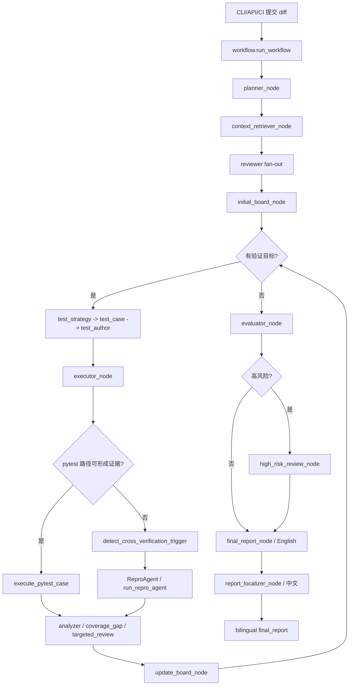

# CodeCross V2 学习文档总览

这个目录按“项目架构 + 每个源码文件一份解析”的方式组织，方便从整体心智模型一路读到函数级别。

## 项目核心
CodeCross 是一个多 Agent 代码审查工作流。它读取 PR diff，检索相关代码上下文，让多个 reviewer 独立提出风险假设，再用 Review Board 记录证据、生成测试、运行 pytest，必要时触发定向复审或 LLM 交叉验证。最终报告先生成英文 canonical report，再由 Report Localizer Agent 翻译成中文，PR 评论会同时发布中英文版本。

核心设计不是“让多个模型聊天”，而是把审查拆成可追踪的证据闭环：

```text
diff
  -> Planner 识别变更、符号和风险方向
  -> Context Retriever 收集本地代码上下文
  -> 多个 Reviewer 独立提出 Finding / TestIntent
  -> Review Board 初始化验证状态和证据
  -> Test Strategy / Test Case / Test Author 生成可执行测试
  -> Executor 安全过滤并真实运行 pytest
      -> pytest 不适用、环境异常或 sanitizer 拦截时，转入 ReproAgent
  -> Board 根据 pytest 或 ReproAgent 证据更新 supported/refuted/inconclusive
  -> Evaluator 规则优先给出最终风险
  -> Final Report 生成英文 canonical report
  -> Report Localizer Agent 翻译成中文
  -> PR Comment / API 输出双语报告
```

## 架构分层
- `schemas.py`：数据契约层，定义所有 Agent、Board、Executor、API 共享的数据对象。
- `config.py` / `llm.py`：运行配置和模型适配层，隔离 API key、provider 差异和 JSON 解析。
- `agents.py`：智能体能力层，负责 prompt、mock、结构化输出、英文最终报告和 Report Localizer Agent。
- `context.py`：上下文检索层，从本地代码里找变更、符号、调用点和测试片段。
- `board.py`：证据黑板层，维护 finding verification、evidence map、verification queue 和停止条件。
- `executor.py`：确定性执行层，负责测试安全检查、pytest 执行、flake 处理和交叉验证接入。
- `workflow.py`：LangGraph 编排层，只决定节点顺序、条件路由和状态合并。
- `api.py` / `storage.py` / `frontend/`：产品化界面层，提供浏览器创建 run、事件流、历史记录和导出能力。
- `ci.py` / `scripts/github_pr_comment.py`：CI 集成层，把 workflow 产生的英文/中文报告一起发布为稳定 PR 评论。
- `cross_verification/`：补充验证层，在 pytest 不能直接给出强证据时让 ReproAgent 做结构化判断。

## 推荐阅读顺序
1. 先读 `codecross__schemas.py.md`，建立所有数据对象的词汇表。
2. 再读 `codecross__workflow.py.md`，理解 LangGraph 节点如何串起来。
3. 接着读 `codecross__agents.py.md`、`codecross__board.py.md`、`codecross__executor.py.md`，这是核心闭环；特别注意 `report_localizer_agent` 只负责最终中文翻译。
4. 想看本地/CI 怎么启动，读 `codecross__main.py.md`、`codecross__ci.py.md`、`scripts__github_pr_comment.py.md`。
5. 想看浏览器产品形态，读 `codecross__api.py.md`、`codecross__storage.py.md`、`frontend__src__App.tsx.md`。
6. 最后读 `tests__*.md`，把测试当成可执行需求说明。

## 关键运行链路


注意：当前源码里 ReproAgent 不是 `workflow.build_graph()` 注册的顶层 LangGraph 节点，而是 `executor_node` 内部的交叉验证子路径：`execute_test_cases -> _run_cross_verification -> run_repro_agent`。架构图把它画出来，是为了学习时不要漏掉这条关键证据路径。

另一个重要变化：旧的本地规则中文化 `codecross/reporting.py` 已删除。现在只有一条中文化路径：`final_report_node` 生成英文报告，`report_localizer_node` 调用 `report_localizer` 模型角色翻译，避免报告正文和 PR 评论各自维护一套中文映射。

## 核心包文档
- [`codecross/__init__.py`](codecross____init__.py.md)
- [`codecross/a2a.py`](codecross__a2a.py.md)
- [`codecross/agents.py`](codecross__agents.py.md)
- [`codecross/api.py`](codecross__api.py.md)
- [`codecross/board.py`](codecross__board.py.md)
- [`codecross/ci.py`](codecross__ci.py.md)
- [`codecross/config.py`](codecross__config.py.md)
- [`codecross/context.py`](codecross__context.py.md)
- [`codecross/cross_verification/__init__.py`](codecross__cross_verification____init__.py.md)
- [`codecross/cross_verification/repro_agent.py`](codecross__cross_verification__repro_agent.py.md)
- [`codecross/cross_verification/triggers.py`](codecross__cross_verification__triggers.py.md)
- [`codecross/executor.py`](codecross__executor.py.md)
- [`codecross/llm.py`](codecross__llm.py.md)
- [`codecross/main.py`](codecross__main.py.md)
- [`codecross/schemas.py`](codecross__schemas.py.md)
- [`codecross/storage.py`](codecross__storage.py.md)
- [`codecross/workflow.py`](codecross__workflow.py.md)

## 前端文档
- [`frontend/index.html`](frontend__index.html.md)
- [`frontend/src/App.tsx`](frontend__src__App.tsx.md)
- [`frontend/src/main.tsx`](frontend__src__main.tsx.md)
- [`frontend/src/styles.css`](frontend__src__styles.css.md)
- [`frontend/vite.config.ts`](frontend__vite.config.ts.md)

## 示例与脚本文档
- [`a2aproject/__init__.py`](a2aproject____init__.py.md)
- [`a2aproject/server.py`](a2aproject__server.py.md)
- [`examples/__init__.py`](examples____init__.py.md)
- [`examples/sample_project/__init__.py`](examples__sample_project____init__.py.md)
- [`examples/sample_project/math_utils.py`](examples__sample_project__math_utils.py.md)
- [`scripts/__init__.py`](scripts____init__.py.md)
- [`scripts/github_pr_comment.py`](scripts__github_pr_comment.py.md)

## 学习原型文档
- [`study/__init__.py`](study____init__.py.md)
- [`study/CodeCrossMiniLangGraph.py`](study__CodeCrossMiniLangGraph.py.md)
- [`study/CodeCrossV0_1.py`](study__CodeCrossV0_1.py.md)
- [`study/miniReActAgent.py`](study__miniReActAgent.py.md)
- [`study/MultiAgents.py`](study__MultiAgents.py.md)
- [`study/SoloAgent.py`](study__SoloAgent.py.md)

## 测试文档
- [`tests/test_a2a.py`](tests__test_a2a.py.md)
- [`tests/test_agents.py`](tests__test_agents.py.md)
- [`tests/test_api.py`](tests__test_api.py.md)
- [`tests/test_board.py`](tests__test_board.py.md)
- [`tests/test_ci.py`](tests__test_ci.py.md)
- [`tests/test_config.py`](tests__test_config.py.md)
- [`tests/test_context.py`](tests__test_context.py.md)
- [`tests/test_cross_verification.py`](tests__test_cross_verification.py.md)
- [`tests/test_cross_verification_e2e.py`](tests__test_cross_verification_e2e.py.md)
- [`tests/test_executor.py`](tests__test_executor.py.md)
- [`tests/test_github_pr_comment.py`](tests__test_github_pr_comment.py.md)
- [`tests/test_llm.py`](tests__test_llm.py.md)
- [`tests/test_self_reference.py`](tests__test_self_reference.py.md)
- [`tests/test_workflow.py`](tests__test_workflow.py.md)

## 覆盖说明
本次共为 49 个源码文件生成了解析文档，每个文档都包含文件作用和函数/类/组件级说明。配置文件如 `pyproject.toml`、`package.json`、`tsconfig.json` 不属于函数型源码，已在架构说明中按职责提及。
